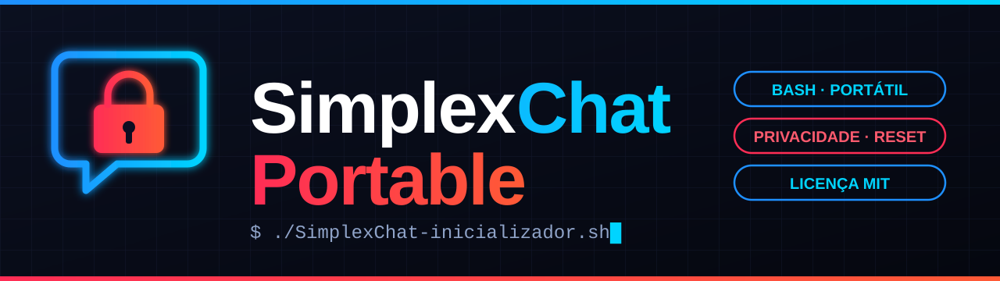

<p align="center">
  
</p>

# SimplexChat-Portable

Scripts em Bash para usar o [SimpleX Chat](https://simplex.chat) de forma **portátil** no Linux: tudo (conversas, contatos, configurações e cache) fica dentro de uma única pasta, que você pode levar num pendrive ou apagar sem deixar rastros no resto do sistema.

## O que tem aqui

| Arquivo | Para que serve |
| --- | --- |
| `SimplexChat-inicializador.sh` | Abre o SimpleX Chat guardando todos os dados na própria pasta do projeto |
| `Reset-SimplexChat.sh` | Menu interativo para resetar o app (completo ou seletivo), com opção de backup |

## Como funciona

O inicializador redireciona as pastas de dados do app para dentro do projeto:

```
dados/    → XDG_DATA_HOME
config/   → XDG_CONFIG_HOME
cache/    → XDG_CACHE_HOME
```

Assim o SimpleX não escreve nada no seu `~/.local`, `~/.config` ou `~/.cache`.

## Instalação

1. Baixe o AppImage do SimpleX Desktop em <https://simplex.chat/downloads/>.
2. Coloque o arquivo nesta pasta com o nome `simplex-desktop.AppImage`.
3. Dê permissão de execução:

```bash
chmod +x simplex-desktop.AppImage SimplexChat-inicializador.sh Reset-SimplexChat.sh
```

## Uso

### Iniciar o SimpleX

```bash
./SimplexChat-inicializador.sh
```

Argumentos extras são repassados para o AppImage.

### Resetar o SimpleX

```bash
./Reset-SimplexChat.sh
```

Menu principal:

| Opção | Ação |
| --- | --- |
| 1 | Reset completo (apaga dados, config, cache e logs de crash) |
| 2 | Reset completo criando um backup antes |
| 3 | Reset seletivo (você escolhe item por item o que apagar) |
| 4 | Status (tamanho atual dos diretórios) |
| 5 | Listar backups salvos |
| 0 | Sair |

Cuidados embutidos no script:

- Avisa se o SimpleX ainda estiver aberto e espera você fechá-lo.
- Mostra exatamente o que será removido e o tamanho de cada item.
- Exige digitar `SIM` para confirmar qualquer exclusão.
- Backups ficam em `backups/` como `.tar.gz` e podem ser restaurados com:

```bash
tar -xzf backups/<arquivo>.tar.gz -C .
```

> ⚠️ O reset apaga conversas, contatos e configurações de forma permanente. Sem backup, não há como recuperar.

## Requisitos

- Linux com Bash
- AppImage do SimpleX Desktop (precisa de FUSE para rodar AppImages)

## Licença

Distribuído sob a licença [MIT](LICENSE).
